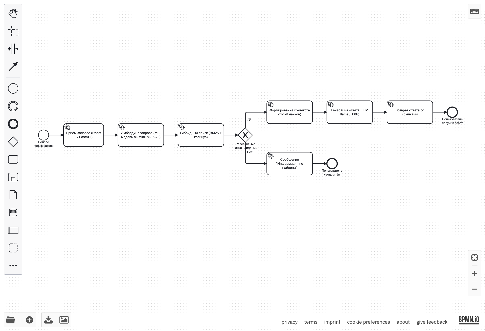

# Схема места ML-модели в процессе LegalHelp

## BPMN-схема



**Источник:** [`Model_BPMN.bpmn`](./Model_BPMN.bpmn) — открывается в [bpmn.io](https://demo.bpmn.io/).

## Описание

### Задача модели в процессе
ML-модель (эмбеддинг-модель `all-MiniLM-L6-v2` + гибридный поиск BM25) решает задачу **семантического поиска** релевантных статей законов по запросу пользователя. На схеме это **Service Task «Эмбеддинг запроса»** и **Service Task «Гибридный поиск»** — ключевые этапы RAG-пайплайна.

### Почему для этой задачи целесообразно использовать ML
- **Семантическое понимание:** пользователи формулируют вопросы своими словами («как расторгнуть договор»), а законы — формальным языком («прекращение договорных обязательств»). Ключевой поиск (BM25) не находит такие совпадения — нужны эмбеддинги.
- **Масштаб:** база содержит 5 млн чанков, ручной поиск невозможен.
- **Точность:** эксперименты показали Precision@5 = 0.87 у гибридного поиска против 0.62 у чистого векторного.

### Входные данные модели
- **Запрос пользователя** (1–500 символов) — приходит из React через FastAPI.
- **База знаний** — 5 011 677 чанков в ChromaDB (векторы + исходные тексты).
- **Параметры поиска** — top-K (по умолчанию 5), веса BM25 и векторного поиска.

### Как используется результат
1. Топ-K чанков передаются в модуль **«Формирование контекста»**.
2. Контекст + вопрос пользователя формируют **промпт** для LLM `llama3.1:8b`.
3. LLM генерирует **ответ** строго на основе найденных чанков.
4. Ответ возвращается пользователю **со ссылками на источники** (номер документа, статья).
5. Если релевантные чанки не найдены — система возвращает «Информация не найдена» (Gateway на схеме).

### Место модели в бизнес-процессе
```
Пользователь → React → FastAPI → [ML-модель: эмбеддинги + гибридный поиск] → LLM → ответ
```
ML-модель — **ядро RAG-пайплайна**, отвечающее за качество извлечения знаний. Без неё система не сможет найти релевантные статьи, и LLM начнёт галлюцинировать.

## Элементы BPMN на схеме

| Элемент | Что обозначает |
|---------|----------------|
| **Start Event** (круг) | Вопрос пользователя |
| **Service Task** (скруглённый прямоугольник) | Автоматический шаг: приём запроса, эмбеддинг, поиск, генерация |
| **Exclusive Gateway** (ромб с «X») | Проверка: «Релевантные чанки найдены?» |
| **Sequence Flow** (стрелки) | Переходы между шагами |
| **End Event** (толстый круг) | Завершение: пользователь получил ответ / уведомлён |