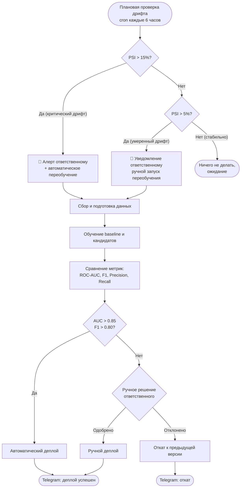

 Схема процесса автоматического переобучения ML-модели

 Диаграмма

 Описание этапов

| Этап                                         | Что происходит                                                                                                | Результат для следующего шага     |
|------                                        |----------------                                                                                               |-------------------------------    |
| Плановая проверка дрифта** (cron каждые 6 ч) | Считается PSI (Population Stability Index) — насколько распределение новых запросов отличается от обучающего. | Значение PSI.                     |
| Проверка критического порога (PSI > 15%)     | Если дрифт превысил 15% — модель деградировала, нужен срочный ответ.                                          | Алерт + запуск авто-переобучения. |
| Проверка умеренного порога (PSI 5–15%)       | Если дрифт небольшой, но заметный — уведомляем ответственного. Он решает: переобучать сейчас или подождать.   | Ручной запуск переобучения.       |
| Если PSI < 5%.                               | Всё стабильно, действий не требуется.                                                                         | Ожидание следующей проверки.      |
| Сбор данных                                  | Новые XML из RusLawOD, проверка целостности.                                                                  | Набор новых XML.                  |
| Обучение                                     | Переиндексация ChromaDB, обучение baseline и кандидатов.                                                      | Новая версия индекса.             |
| Сравнение метрик                             | ROC-AUC, F1, Precision, Recall, Accuracy. Сравнение с baseline и текущей production-версией.                  | Таблица метрик.                   |
| Проверка порога качества                     | Если AUC > 0.85 и F1 > 0.80 — авто-деплой. Иначе — ручной режим.                                              | Решение: «авто» / «ручной».       |
| Ручное решение                               | Ответственный смотрит метрики и 10 случайных ответов. Решает: одобрить или откатить.                          | Решение: «одобрить» / «откатить». |
| Деплой                                       | Переключение версии, перезапуск бэкенда.                                                                      | Новая модель в продакшене.        |        
| Откат                                        | Возврат к предыдущей стабильной версии.                                                                       | Старая модель активна.            |  
| Уведомление                                  | Telegram-сообщение об успехе или откате.                                                                      | Запись в лог.                     | 

Триггеры переобучения

 1. Автоматические (по дрифту)

| Условие   | Действие                                                    |
|---------  |-------------------------------------------------------------|
| PSI > 15% | Критический дрифт → **алерт + автоматическое переобучение** |
| PSI 5–15% | Умеренный дрифт → уведомление ответственному, ручной запуск |
| PSI < 5%  | Стабильно → ничего не делать |

 2. По качеству RAG (на контрольном наборе 500 вопросов)

| Метрика      | Порог  | Действие             |
|--------------|--------|----------------------|
| Faithfulness | < 0.85 | Триггер переобучения |
| Precision.   | < 0.80 | Триггер переобучения |
| MRR          | < 0.75 | Триггер переобучения |

 3. По расписанию
- Ежедневное обновление RusLawOD (cron в 2:00) — если появились новые файлы.

4. Ручной запуск
- Юрист инициирует переобучение после крупных изменений в законодательстве.

Метрики, пороги и их смысл

Метрики ранжирования (для поиска)

| Метрика | Что показывает | Порог |
|---------|----------------|-------|
| **Precision@5** | Из 5 найденных — сколько релевантных | ≥ 0.85 |
| **Recall@5** | Из всех релевантных — сколько в топ-5 | ≥ 0.80 |
| **MRR** | Как быстро находится первый релевантный | ≥ 0.80 |
| **ROC-AUC** | Насколько хорошо ранжирует | ≥ 0.85 |

Метрики классификации (для бинарной задачи «релевантно/нет»)

| Метрика   | Что показывает                                |  Порог |
|-----------|-----------------------------------------------|--------|
| Accuracy  | Доля правильных предсказаний                  | ≥ 0.85 |
| Precision | Из предсказанных релевантными — сколько верны | ≥ 0.85 |
| Recall.   | Из всех релевантных — сколько нашли           | ≥ 0.80 |
| F1        | Баланс Precision и Recall                     | ≥ 0.80 |

 Метрика дрифта

| Метрика | Что показывает                            | Пороги                                                     |
|---------|-------------------------------------------|------------------------------------------------------------|
| PSI.    | Насколько изменилось распределение данных | < 5% — норма; 5–15% — умеренный дрифт; > 15% — критический |

Human-in-the-loop

Если порог качества не достигнут (AUC < 0.85 или F1 < 0.80), ответственный проверяет 10 случайных ответов новой версии. Если 9/10 корректны — версия одобряется. Иначе — откат.

Реализация

- Проверка дрифта: ml_experiments/drift_check.py (PSI по новым запросам).
- Переиндексация:  load_to_chromadb.py --full-reload.
- Валидация:       ml_experiments/evaluate_rag.py` (Precision@5, Recall@5, MRR, Faithfulness).
- Аукцион по AUC:  ml_experiments/auc_auction.py` (сравнение двух версий).
- Деплой:          deploy_model.sh` (переключение папок + перезапуск uvicorn).
- Уведомления:     notify_telegram.py.
- Логирование:     logs/retrain.log.