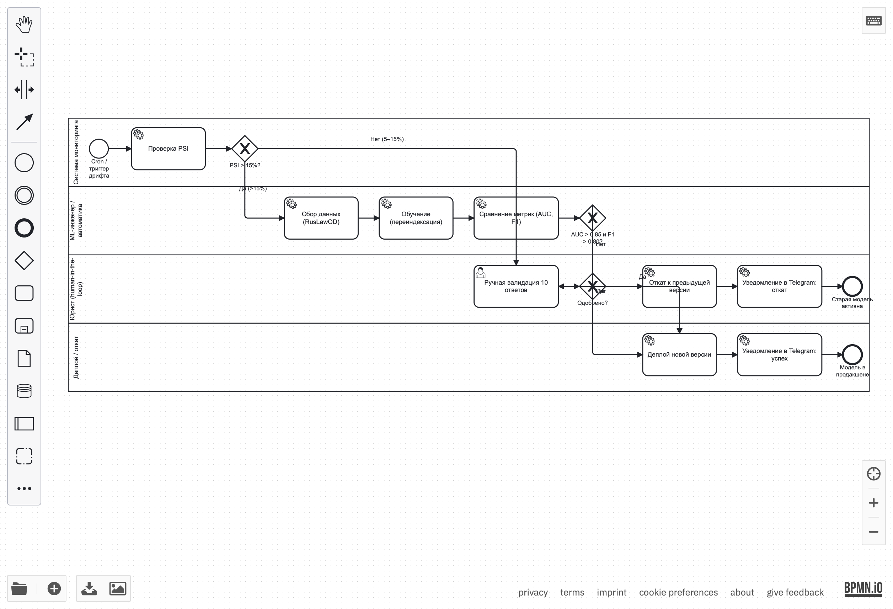

 # Схема процесса автоматического переобучения ML-модели

## BPMN-схема с дорожками (swimlanes)

**Источник:** [`Model_retrain_BPMN.bpmn`](./Model_retrain_BPMN.bpmn) — открывается в [bpmn.io](https://demo.bpmn.io/).

### Дорожки (зоны ответственности)

| Дорожка | Кто отвечает | Что делает |
|---------|--------------|------------|
| **Система мониторинга** | Автоматика (cron) | Проверяет PSI, детектит дрифт, принимает решение о критичности |
| **ML-инженер / автоматика** | Скрипты + инженер | Собирает данные, переобучает, сравнивает метрики |
| **Юрист (human-in-the-loop)** | Юрист | Валидирует 10 случайных ответов новой версии |
| **Деплой / откат** | Автоматика | Публикует новую версию или откатывает, уведомляет в Telegram |

## Описание этапов

| Этап | Дорожка | Что происходит | Результат для следующего шага |
|------|---------|----------------|-------------------------------|
| **Триггер (cron / дрифт)** | Мониторинг | Cron каждые 6 часов запускает проверку PSI | Значение PSI |
| **Проверка PSI > 15%** | Мониторинг | Gateway: если PSI > 15% — критический дрифт | Ветвление: критично / умеренно |
| **Сбор данных** | ML | Новые XML из RusLawOD, проверка целостности | Набор новых XML |
| **Обучение** | ML | Переиндексация ChromaDB, обучение baseline и кандидатов | Новая версия индекса |
| **Сравнение метрик** | ML | ROC-AUC, F1, Precision, Recall. Сравнение с baseline | Таблица метрик |
| **Проверка AUC > 0.85 и F1 > 0.80** | ML | Gateway: если да — авто-деплой, если нет — ручная валидация | Решение: авто / ручной |
| **Ручная валидация** | Юрист | Проверяет 10 случайных ответов новой версии | Решение: одобрить / отклонить |
| **Деплой** | Деплой | Переключение версии, перезапуск бэкенда | Новая модель в продакшене |
| **Откат** | Деплой | Возврат к предыдущей стабильной версии | Старая модель активна |
| **Уведомление в Telegram** | Деплой | Сообщение об успехе или откате | Запись в лог |

## Триггеры переобучения

### 1. Автоматические (по дрифту)

| Условие | Действие |
|---------|----------|
| **PSI > 15%** | Критический дрифт → алерт + автоматическое переобучение |
| **PSI 5–15%** | Умеренный дрифт → уведомление ответственному, ручной запуск |
| **PSI < 5%** | Стабильно → ничего не делать |

### 2. По качеству RAG (на контрольном наборе 500 вопросов)

| Метрика | Порог | Действие |
|---------|-------|----------|
| Faithfulness | < 0.85 | Триггер переобучения |
| Precision@5 | < 0.80 | Триггер переобучения |
| MRR | < 0.75 | Триггер переобучения |

### 3. По расписанию
- Ежедневное обновление RusLawOD (cron в 2:00) — если появились новые файлы.

### 4. Ручной запуск
- Юрист инициирует переобучение после крупных изменений в законодательстве.

## Метрики, пороги и их смысл

### Метрики ранжирования (для поиска)

| Метрика | Что показывает | Порог |
|---------|----------------|-------|
| **Precision@5** | Из 5 найденных — сколько релевантных | ≥ 0.85 |
| **Recall@5** | Из всех релевантных — сколько в топ-5 | ≥ 0.80 |
| **MRR** | Как быстро находится первый релевантный | ≥ 0.80 |
| **ROC-AUC** | Насколько хорошо ранжирует | ≥ 0.85 |

### Метрики классификации (бинарная задача «релевантно / нет»)

| Метрика | Что показывает | Порог |
|---------|----------------|-------|
| **Accuracy** | Доля правильных предсказаний | ≥ 0.85 |
| **Precision** | Из предсказанных релевантными — сколько верны | ≥ 0.85 |
| **Recall** | Из всех релевантных — сколько нашли | ≥ 0.80 |
| **F1** | Баланс Precision и Recall | ≥ 0.80 |

### Метрика дрифта

| Метрика | Что показывает | Пороги |
|---------|----------------|--------|
| **PSI** | Насколько изменилось распределение данных | < 5% — норма; 5–15% — умеренный дрифт; > 15% — критический |

## Human-in-the-loop

Если порог качества не достигнут (AUC < 0.85 или F1 < 0.80), юрист проверяет 10 случайных ответов новой версии. Если 9/10 корректны — версия одобряется. Иначе — откат.

## Реализация

- **Проверка дрифта:** `ml_experiments/drift_check.py` (PSI по новым запросам).
- **Переиндексация:** `load_to_chromadb.py --full-reload`.
- **Валидация:** `ml_experiments/evaluate_rag.py` (Precision@5, Recall@5, MRR, Faithfulness).
- **Аукцион по AUC:** `ml_experiments/auc_auction.py`.
- **Деплой:** `deploy_model.sh` (переключение папок + перезапуск uvicorn).
- **Уведомления:** `notify_telegram.py`.
- **Логирование:** `logs/retrain.log`.