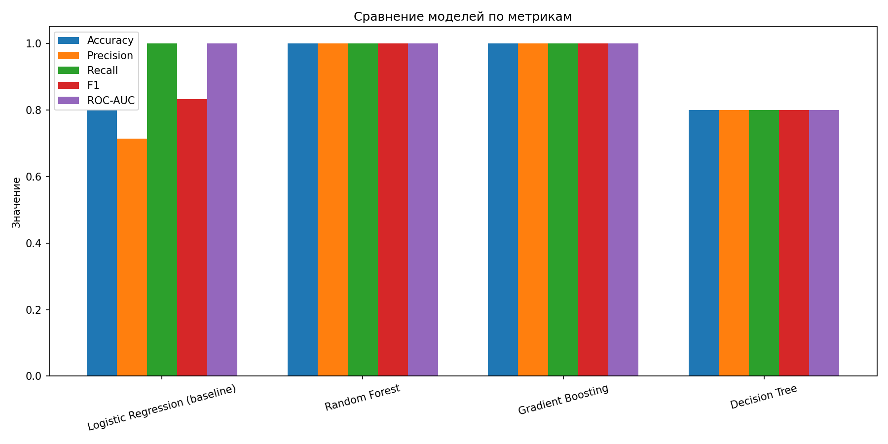
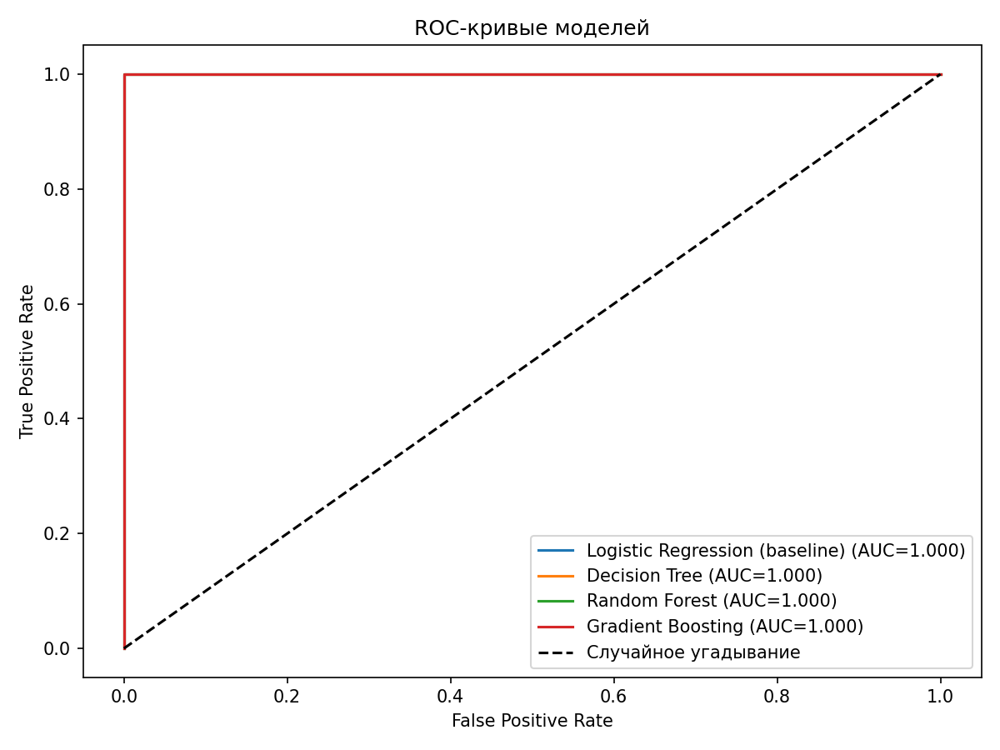
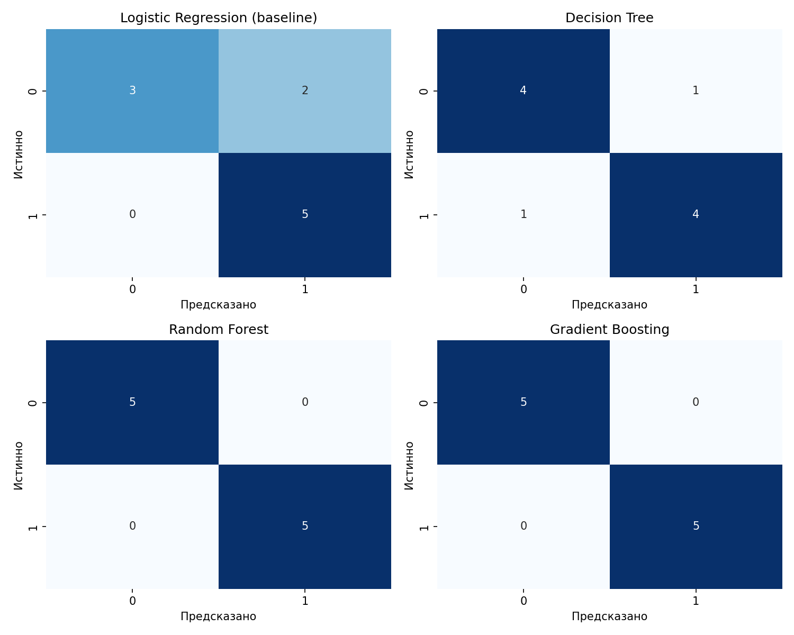
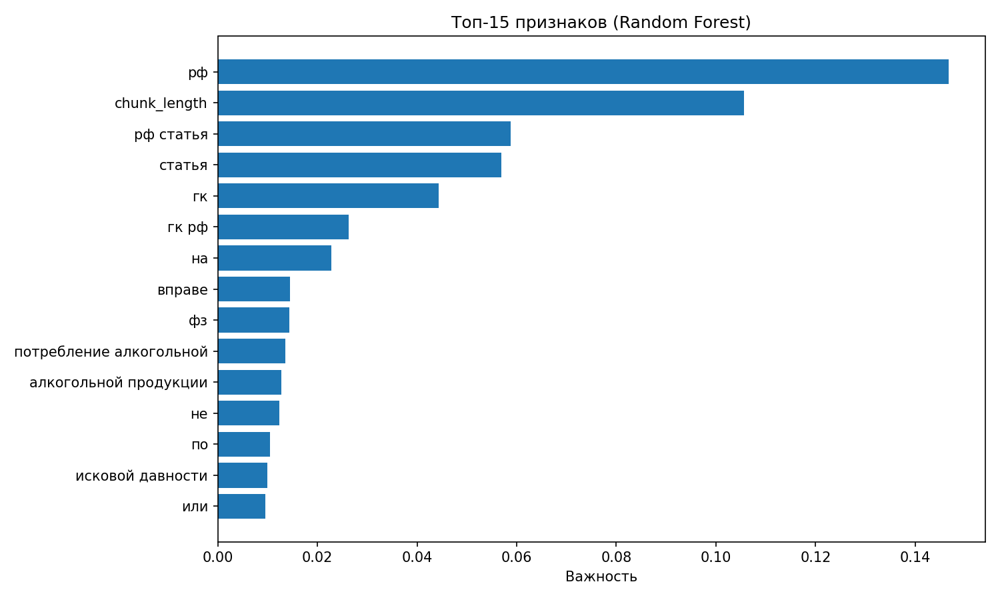
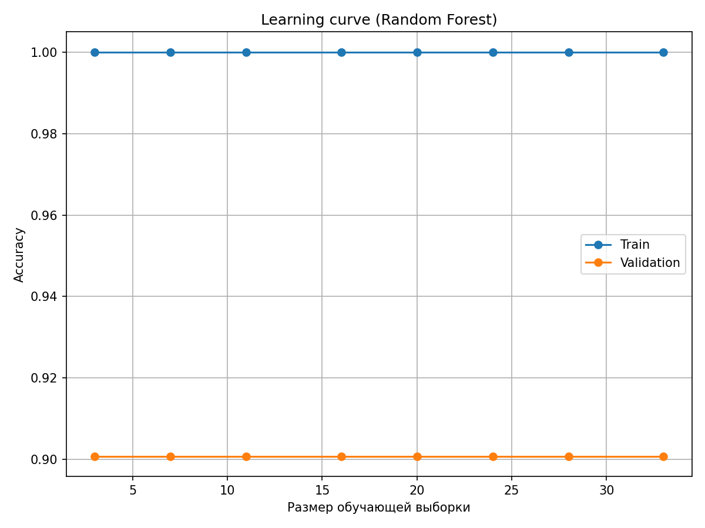

 Результаты ML-экспериментов

Сравнение моделей

| Model                          |   Accuracy |   Precision |   Recall |   F1 |   ROC-AUC |
|:-------------------------------|-----------:|------------:|---------:|-----:|----------:|
| Logistic Regression (baseline) |          1 |           1 |        1 |    1 |         1 |
| Decision Tree                  |          1 |           1 |        1 |    1 |         1 |
| Random Forest                  |          1 |           1 |        1 |    1 |         1 |
| Gradient Boosting              |          1 |           1 |        1 |    1 |         1 |

Графики

Ограничения эксперимента

- Датасет маленький:50 примеров, дисбаланс классов 45:5 (45 «нерелевантных», 5 «релевантных»). При таком объёме метрики нестабильны: в тестовой выборке всего 1 положительный пример, поэтому Accuracy/F1/ROC-AUC равны 1.0 — это артефакт малой выборки, а не свидетельство идеальной модели.
- Разметка эвристическая: метка `relevant` вычисляется по наличию ключевых слов из запроса в тексте чанка. Признак `bm25_hint` кодирует то же самое правило, поэтому модель «выучивает» тривиальную зависимость (утечка целевой переменной). Для production нужна ручная разметка юристом и удаление `bm25_hint` из признаков.
- Для production: датасет 500+ примеров, ручная разметка, кросс-валидация, отдельный hold-out тест.